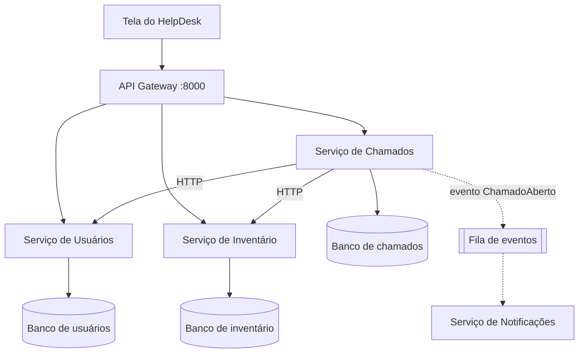

# HelpDesk TI · Microsserviços

Sistema de chamados de TI (GLPI simplificado) migrado do **monólito** para **microsserviços**.
Atividade individual de **Arquitetura de Software** — Prof. Filipe Cavalcante.

**Aluno:** Valker Soares · **Matrícula:** 01291202 · **Turma:** quarto período A

**Vídeo de demonstração:** [COLAR AQUI O LINK DO VÍDEO]  <!-- YouTube não listado ou Google Drive com acesso por link -->

---

## 1. Arquitetura



Três serviços obrigatórios (Usuários, Inventário e Chamados), cada um com o **seu próprio
banco**, atrás de um **gateway** que é o único ponto de entrada. O serviço de Chamados fala
com Usuários e Inventário por **HTTP**, com *timeout* e tratamento de falha.

## 2. O que cada serviço faz

| Serviço | Porta | Responsabilidade | Banco |
|---|---|---|---|
| **gateway** | 8000 | Único ponto de entrada; encaminha cada rota para o serviço certo | — |
| **usuarios** | 8001 | Login (JWT), contas e perfis | `usuarios.db` |
| **inventario** | 8002 | Equipamentos de TI | `inventario.db` |
| **chamados** | 8003 | Chamados, SLA, status, comentários, painel | `chamados.db` |
| **notificacoes** | 8004 | Consome eventos e grava avisos (bônus) | `notificacoes.db` |

## 3. Como rodar

```shell
cp .env.example .env      # ajuste o JWT_SEGREDO se quiser
docker compose up --build
```

Depois de subir:

- Tela do HelpDesk: <http://localhost:8000>
- Documentação da API: <http://localhost:8000/docs>

Conferir os contêineres:

```shell
docker compose ps
```

Contas de exemplo (senha `Helpdesk2026`): `admin@empresa.com`, `carla@empresa.com`,
`diego@empresa.com`, `ana@empresa.com`, `bruno@empresa.com`.

## 4. Decisões de arquitetura

### 4.1 Banco por serviço, sem chave estrangeira cruzada

Cada serviço tem o seu banco. A tabela `chamados` guarda apenas `solicitante_id`,
`tecnico_id` e `ativo_id` como **referências**, sem `FOREIGN KEY` para tabelas de outro
serviço — que agora vivem em outro processo e outro banco. A consistência dessas referências
é conferida **na chamada HTTP**, no momento do uso.

Consequência aceita: não existe mais *join* entre chamado e nome do técnico. O serviço de
Chamados busca os dados que faltam por HTTP e monta a resposta.

### 4.2 Comunicação síncrona por HTTP, com timeout

O serviço de Chamados chama `GET /usuarios/{id}` e `GET /ativos/{id}` antes de atribuir.
Cada chamada tem **timeout de 2 s** e repassa o token do usuário no cabeçalho
`Authorization`, para que a autorização continue valendo no serviço chamado.

### 4.3 Falha de um vizinho não derruba o sistema

Se Usuários ou Inventário estiverem fora do ar, Chamados responde **503** com uma mensagem
clara em vez de travar ou devolver erro genérico. Listagens que não dependem do vizinho
continuam funcionando — é exatamente o que o vídeo demonstra com
`docker compose stop inventario`.

### 4.4 Um login só, token conferido em todo serviço

O login fica no serviço de **Usuários**. O `JWT_SEGREDO` vem do `.env` e é o mesmo em todos
os serviços, então cada um confere o token localmente, sem chamar ninguém. As permissões por
perfil (o solicitante só vê os próprios chamados, por exemplo) continuam valendo dentro de
cada serviço.

### 4.5 Só o gateway fica exposto

Os serviços e os bancos **não publicam portas** para fora do Docker. Só o gateway responde
na porta 8000. Dentro da rede do Compose os serviços se encontram pelo nome
(`http://usuarios:8000`), nunca por `localhost`.

### 4.6 Consequências: o que melhorou e o que ficou mais difícil

**Melhorou:** cada serviço pode ser publicado e escalado sozinho; uma falha fica contida no
serviço afetado; cada time mexe no seu banco sem combinar migração com os outros.

**Ficou mais difícil:** agora existe a rede no meio — latência, timeout, serviço fora do ar
e dados que antes vinham de um `join` e agora exigem mais de uma chamada. Ganhamos
autonomia e pagamos em complexidade operacional.

## 5. Bônus implementados

- **Notificações por evento:** Chamados publica `ChamadoAberto`, `ChamadoAtribuido` e
  `ChamadoResolvido` numa fila; o serviço de Notificações consome e grava os avisos. Se
  Notificações cair, os chamados continuam sendo abertos.
- **Rota de saúde:** cada serviço expõe `GET /saude` e o gateway mostra quais estão no ar em
  `GET /saude`.
- **Testes por serviço:** cada serviço com a sua suíte, rodando no GitHub Actions.

## 6. Estrutura do repositório

```
helpdesk-microsservicos-valker-soares/
├── docker-compose.yml
├── .env.example
├── gateway/            # ponto de entrada :8000 — repassa as rotas com httpx
│   ├── app/main.py
│   └── Dockerfile
├── servicos/
│   ├── usuarios/       # login, contas, perfis (porta 8001)
│   ├── inventario/     # equipamentos (porta 8002)
│   ├── chamados/       # chamados, SLA, painel (porta 8003)
│   └── notificacoes/   # consumidor da fila de eventos (porta 8004)
├── tests/
└── docs/
```

## 7. Roteiro do vídeo (4 a 6 min)

1. Arquitetura — diagrama acima, explicando os serviços e como conversam
2. `docker compose up --build` e `docker compose ps` com tudo no ar
3. Fluxo completo pela tela, passando pelo gateway
4. Segurança — chamada sem token recebendo 401 e solicitante não vendo chamado de outro
5. Bancos separados — os volumes de cada serviço
6. Falha de serviço — `docker compose stop inventario`, erro claro ao abrir chamado com
   equipamento, listas seguem funcionando, e `docker compose start inventario`
7. O que é novo em relação ao monólito — o que melhorou e o que ficou mais difícil
8. Bônus — eventos chegando em Notificações e os testes rodando
